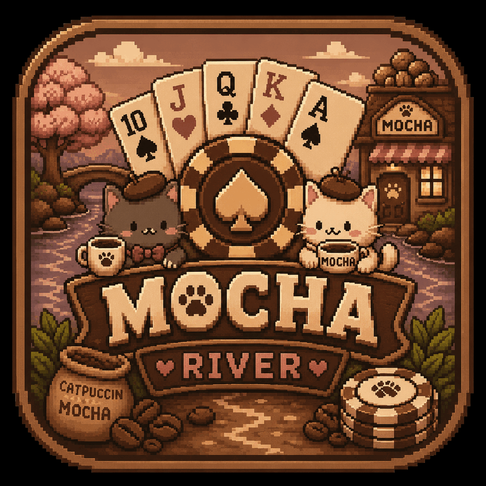

# Mocha River

<div align="center">
  
</div>

Offline Texas Hold'em Poker — 1 pemain vs 3 bot. React Native + Expo.

## Install & Jalankan

```bash
cd poker-app
npm install
npx expo start
```

Scan QR dengan Expo Go, atau tekan `a` untuk Android emulator.

## Build APK

```bash
npx eas build --platform android --profile preview
```

## Cara Main

### Setup
Setiap pemain mendapat dua kartu pribadi (*hole cards*). Lima kartu komunitas dibuka di meja dalam tiga tahap: **The Flop** (3 kartu), **The Turn** (1 kartu), **The River** (1 kartu).

Tujuan: buat kombinasi 5 kartu poker terbaik dari 2 hole cards + 5 kartu komunitas.

### Ronde Taruhan
Ada empat ronde taruhan, dimulai dari pemain aktif pertama searah jarum jam:
1. **Pre-Flop** — setelah hole cards dibagikan
2. **Flop** — setelah 3 kartu komunitas pertama
3. **Turn** — setelah kartu komunitas ke-4
4. **River** — setelah kartu komunitas ke-5

### Aksi
- **Fold** — menyerah, keluar dari hand
- **Check** — lolos jika belum ada taruhan
- **Call** — memasang taruhan yang sama
- **Raise** — menaikkan taruhan (slider 5+/10+/20+/100+/1000+)
- **All-In** — mempertaruhkan semua chip

### Blinds
Sebelum setiap hand, dua pemain memasang taruhan paksa: **Small Blind** (setengah minimum) dan **Big Blind** (minimum). Blind naik tiap 6 hand (10/20 → 200/400).

### Peringkat Kartu (tertinggi ke terendah)
1. **Royal Flush** — A, K, Q, J, 10 suit sama
2. **Straight Flush** — 5 kartu berurutan suit sama
3. **Four of a Kind** — 4 kartu rank sama
4. **Full House** — 3 kartu rank sama + 1 pasang
5. **Flush** — 5 kartu suit sama
6. **Straight** — 5 kartu berurutan
7. **Three of a Kind** — 3 kartu rank sama
8. **Two Pair** — 2 pasang berbeda
9. **One Pair** — 2 kartu rank sama
10. **High Card** — kartu tertinggi

### Menang
Menang dengan memiliki kartu terbaik saat **Showdown**, atau membuat semua lawan fold sebelum River. Pot diberikan ke pemenang — atau dibagi jika kartu identik (split pot).

### Lainnya
- **Side pot** otomatis untuk all-in multi pemain
- **Dealer button** (D) bergilir tiap hand
- Bot AI dengan 3 tingkat kesulitan (Easy/Medium/Hard)

## Struktur

```
src/
  components/   — PokerCard, PlayerSeat, RaiseSlider, GameStatusBanner, ShowdownModal
  screens/      — Home, Game, Tutorial, Settings, Profile
  game/         — deck, handEvaluator, botAI, gameEngine, types
  store/        — gameStore, settingsStore (Zustand)
  utils/        — storage, format, soundManager, i18n
  constants/    — theme (Catppuccin Mocha), lang (EN/ID)
```

## Fitur

- **i18n** — EN/ID, 120+ key, toggle di Settings
- **Tutorial** — 7 basics + 10 hand rankings, full translated
- **Table themes** — Classic Green, Royal Blue, Midnight Purple, Crimson, Emerald
- **Card backs** — Classic, Diamond, Royal (CSS-only)
- **Sound packs** — Classic, Arcade, Muted (synthesized WAV, 9 suara per pack)
- **Bot difficulty** — Easy / Medium / Hard (aggression & mistakes)
- **Raise slider** — preset 5+/10+/20+/100+/1000+ + draggable
- **Stats tracking** — hands played, win rate, biggest win (persisted)
- **Profile** — custom photo (image picker) + editable name
- **Splash background** — semua halaman pakai splash-icon.png
- **Chip logo MR** — Mocha River chip icon di semua seat & pot
- **Dealer badge** — lingkaran hitam "D" di avatar dealer
- **Hand history** — review detail setiap hand setelah showdown
- **Card flip animation** — spring animation pada deal
- **Kartu render View+Text** (tanpa image), ukuran 56×80 / 48×64
- **Hand evaluator** C(7,5) — semua 10 ranking + wheel straight
- **Chip balance persist** di AsyncStorage
- **Dark theme Catppuccin Mocha**, Montserrat font

## Tech Stack

React Native / Expo SDK 54, TypeScript, Zustand, AsyncStorage,
React Navigation, expo-av, expo-font, expo-image-picker,
expo-linear-gradient, @expo/vector-icons.
